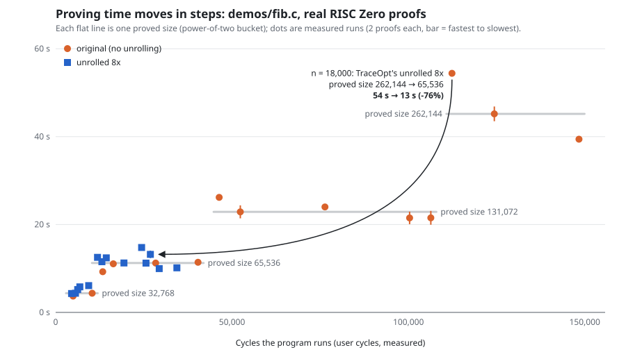
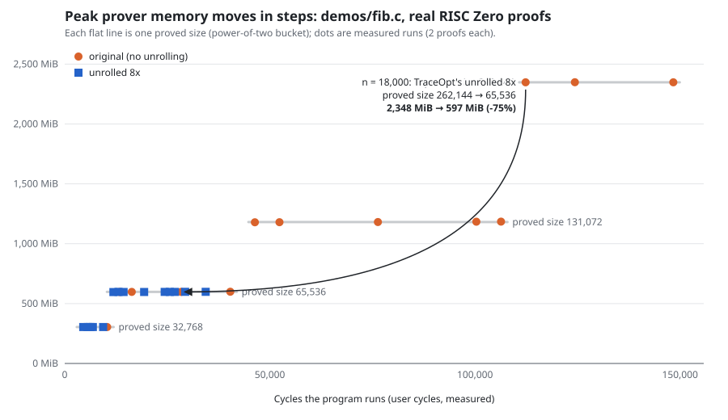

# Real proofs: original vs TraceOpt's choice

Each file is one run of `scripts/prove_compare.sh`: the original (no
unrolling) and the version TraceOpt chose were proved alternately, 3 times
each, with RISC Zero 3.0.6 on the CPU prover (WSL, about 7.6 GB of RAM).
Every proof was verified, and every answer matched the native build.

Composite receipts (one STARK proof per segment; every run here is one
segment):

| Program and inputs | Chosen | Proved size | Proving time (median) | Peak memory | Proof size |
|---|---|---|---|---|---|
| `strided_rw 5` | 4x | 262,144 → 131,072 (−50%) | 51.0 s → 30.9 s (−39.4%) | 2,347 → 1,186 MiB (−49.5%) | 255,656 → 243,944 B (−4.6%) |
| `demos/fib.c 20000` | 8x | 262,144 → 65,536 (−75%) | 56.3 s → 15.7 s (−72.1%) | 2,349 → 598 MiB (−74.5%) | 255,656 → 220,904 B (−13.6%) |
| `demos/array_sum.c 12000` | 8x | 262,144 → 131,072 (−50%) | 58.4 s → 28.6 s (−51.1%) | 2,349 → 1,182 MiB (−49.7%) | 255,656 → 243,944 B (−4.6%) |
| `demos/counter.c 1000 3` | 8x | 65,536 → 32,768 (−50%) | 12.9 s → 7.2 s (−44.5%) | 597 → 304 MiB (−49.0%) | 220,904 → 209,256 B (−5.3%) |

Succinct receipt (the segment proofs compressed into one proof, the step
before the Groth16 proof that is verified on-chain):

| Program and inputs | Chosen | Proved size | Proving time (median) | Peak memory | Proof size |
|---|---|---|---|---|---|
| `demos/fib.c 20000` | 8x | 262,144 → 65,536 (−75%) | 67.7 s → 28.3 s (−58.2%) | 2,349 → 1,419 MiB (−39.6%) | 222,668 → 222,668 B (0%) |

## The staircase

`staircase-fib.json`: `demos/fib.c` proved at 14 inputs (n = 100 to
24,000), original and unrolled 8x, 2 proofs each: 28 points, every answer
correct. Proving cost follows the proved size, not the cycles the program
runs:

| Proved size | Runs | Program cycles in this bucket | Proving time (median; range) | Peak memory (median) |
|---|---|---|---|---|
| 32,768 | 7 | 4,508 – 10,354 | 4.4 s (3.7 – 6.1) | 304 MiB |
| 65,536 | 13 | 11,862 – 40,354 | 11.2 s (9.3 – 14.8) | 597 MiB |
| 131,072 | 5 | 46,354 – 106,354 | 22.9 s (21.5 – 26.2) | 1,181 MiB |
| 262,144 | 3 | 112,354 – 148,354 | 45.2 s (39.4 – 54.4) | 2,348 MiB |

Inside the 65,536 bucket the program ran from 11,862 to 40,354 cycles
(3.4 times as many) and proving time stayed between 9.3 and 14.8 s; each
step up roughly doubles time and exactly doubles memory.

Redraw with `python3 scripts/plot_staircase.py
results/proving/staircase-fib.json --highlight 18000`.

## What the comparisons show

- Proving time and memory follow the proved (padded) size, which is what
  TraceOpt predicts: halving the size roughly halved memory and cut time by
  39–51%; quartering it cut both by about three quarters.
- The per-segment proofs get slightly smaller, because a STARK proof grows
  with the logarithm of the trace length. A compressed (succinct) proof has
  the same size for both versions: no program change can shrink it, but it
  still takes less time to generate.
- Proving times vary between runs by up to about 75% on this laptop (e.g.
  35.8 s to 62.9 s for the same proof; the individual times are in each
  file), which is why the two versions alternate. In every pair, the chosen
  version was proved faster.
